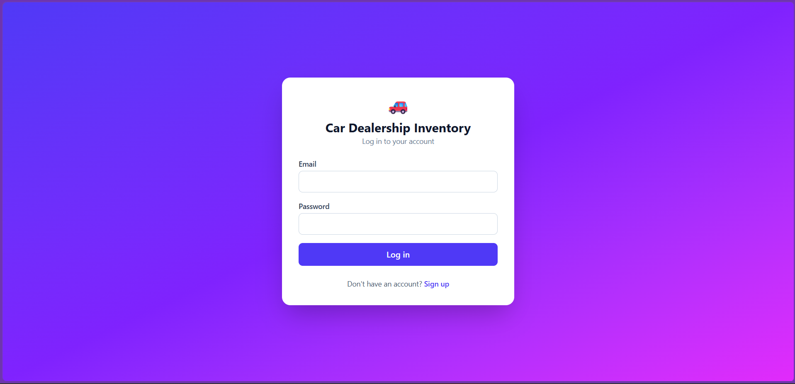
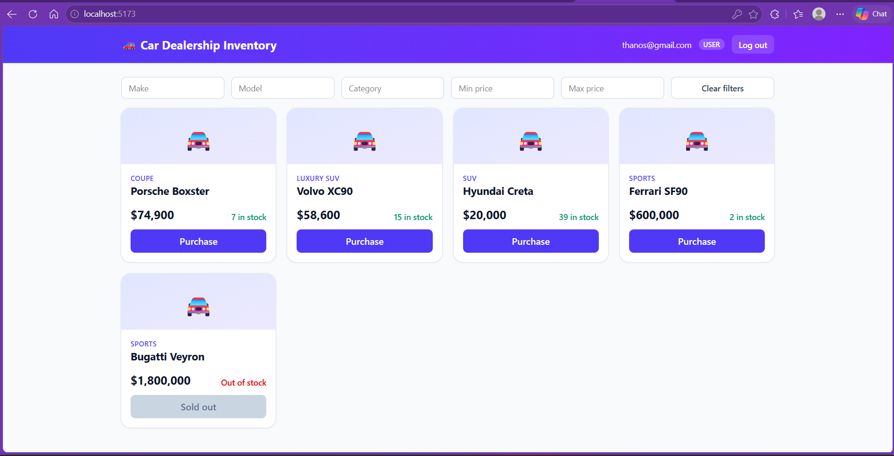
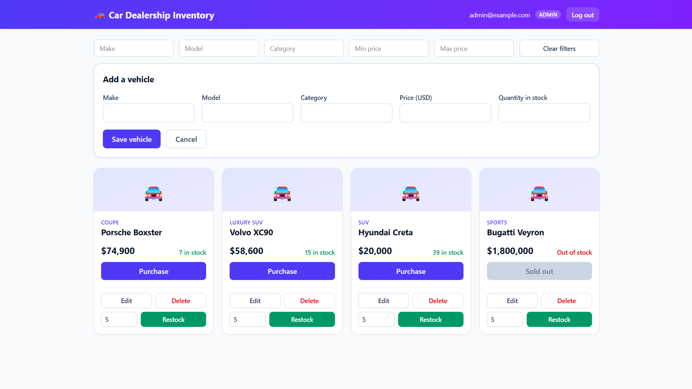
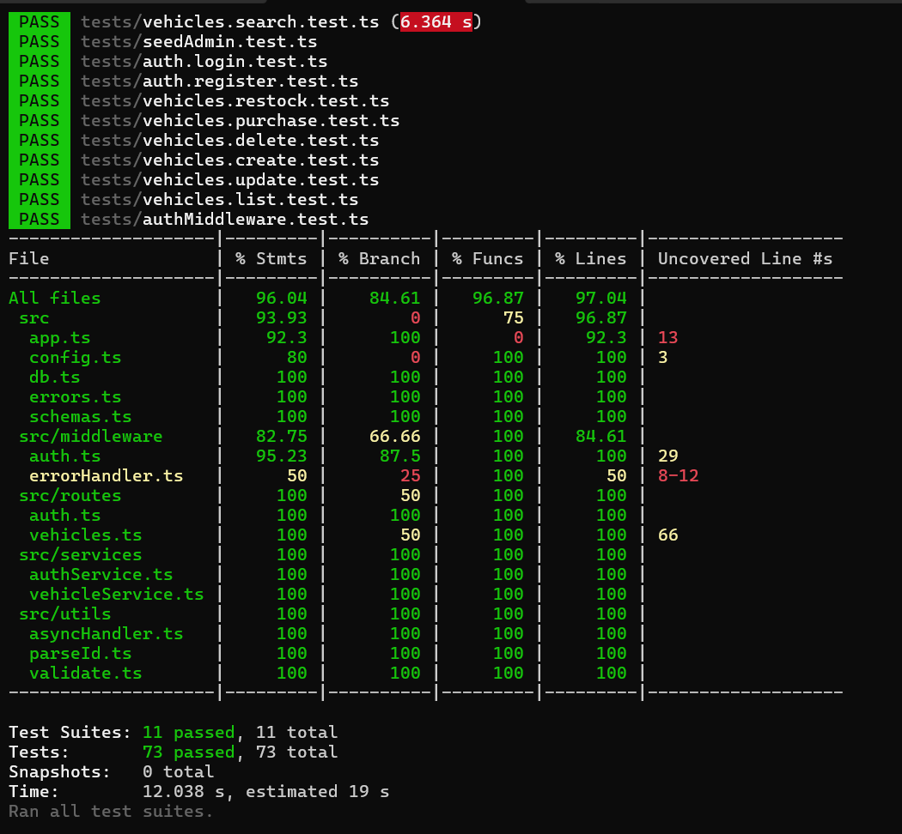

# Car Dealership Inventory System

Full-stack TDD kata: REST API (Node, TypeScript, Express, Prisma, SQLite) + React SPA (Vite, Tailwind).

## Features
- Register/login with JWT auth; roles USER and ADMIN
- Vehicle CRUD, search (make, model, category, price range), purchase and restock with atomic stock updates
- React SPA: dashboard, live search/filters, Purchase button (disabled at quantity 0), admin add/edit/delete/restock

## Tech stack
- Backend: Node.js, TypeScript, Express, Prisma (SQLite), JWT, bcryptjs, zod
- Tests: Jest, Supertest
- Frontend: React, Vite, Tailwind CSS, HTML5/CSS3

## API
| Method | Path | Access |
|---|---|---|
| POST | /api/auth/register, /api/auth/login | public |
| POST | /api/vehicles | logged in |
| GET | /api/vehicles, /api/vehicles/search | logged in |
| PUT | /api/vehicles/:id | logged in |
| DELETE | /api/vehicles/:id | admin |
| POST | /api/vehicles/:id/purchase | logged in |
| POST | /api/vehicles/:id/restock | admin |

## Getting started
**Backend** (Node 20+)
```bash
cd backend
npm install
cp .env.example .env      # Windows: copy .env.example .env  (then edit values)
npx prisma db push
npm run seed:admin        # creates the admin from ADMIN_EMAIL / ADMIN_PASSWORD
npm run dev               # http://localhost:3000
```
**Frontend**
```bash
cd frontend
npm install
npm run dev               # http://localhost:5173 (proxies /api to :3000)
```

## Running tests
```bash
cd backend && npm test            # 73 tests; npm run test:coverage for coverage
cd frontend && npm test
```

## Design decisions
- **Roles:** `User.role` is `USER` or `ADMIN`. Registration always creates `USER`; the admin is seeded by a script using env vars.
- **Listing:** `GET /api/vehicles` returns all vehicles, including quantity 0, so the UI can show a disabled Purchase button.
- **Purchase:** optional `quantity` (default 1); decrement is atomic and returns 409 when stock is insufficient.
- **Restock:** positive integer quantity, admin only.
- **Search:** `make`, `model`, `category`, `minPrice`, `maxPrice`; case-insensitive partial match.
- **Errors:** consistent `{ "error": "message" }` shape.

## Screenshots




## Test report
73 backend tests, all passing; ~96% statement coverage. Full output: [docs/test-report.txt](docs/test-report.txt).


Known gaps: some error-handler branches (malformed JSON, 500s) are untested; no frontend end-to-end tests.

## Known limitations / next steps
- POST and PUT on vehicles allow any logged-in user (the spec only requires admin for delete and restock); the UI only exposes them to admins.
- The JWT lives in localStorage (simple, but exposed to XSS); no refresh tokens.
- No pagination; the UI purchases one unit per click (the API supports a quantity).
- Not deployed.

## My AI Usage
**Tool:** Claude (claude.ai chat), used for the whole project. No other AI tools.

**How I used it:**
- Broke down the assignment and the JD into a checklist, and planned the stack and phases.
- For each backend slice, Claude drafted the failing test first, I ran it to confirm it was red, committed it, then used Claude's implementation, confirmed green and committed. Claude also suggested the atomic conditional `updateMany` for purchases, which my concurrency test verifies.
- Claude drafted the React components, API client and VehicleCard tests; I ran the tests and the production build and tested the flows by hand.
- Debugging help: I used Claude to troubleshoot an install conflict where an unpinned TypeScript 7 broke `ts-jest`; I fixed it by pinning TypeScript 5.9.3. It also helped me spot and fix two mistakes in my project setup and Git workflow: the first scaffold commit was missing `src/app.ts`, `src/server.ts` and the `tests/` folder, so Jest and `tsc` failed on a clean run, and the co-author trailer I copied from the assignment's example resolved to a real GitHub user ("ai"), who then appeared as a contributor, so I rewrote the commit messages to use `noreply@anthropic.com`. I also used it for the frontend setup and to extract a shared `parseId` helper so vehicle ID validation is consistent across routes. In each case I ran the commands and tests myself to verify the result. See `docs/ai-gotchas.md` for details.

**Reflection:** AI made me faster by breaking the project into manageable steps, drafting tests, and suggesting implementations. But I couldn't treat its output as correct: I ran every test suite to confirm it failed before implementing and passed afterwards, read the errors myself, and verified that each change actually worked. The behaviour decisions were mine, such as listing sold-out vehicles so the Purchase button can be disabled, ignoring any role sent at registration, and returning 409 for insufficient stock. With more time I'd review authentication and authorization more closely, along with purchase concurrency and edge cases, before calling this production-ready.

Full raw chat link: see [PROMPTS.md](PROMPTS.md).
